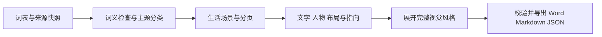

# 词汇场景漫画提示词

把英语词表整理成主题、生活场景和漫画页面，再导出可直接交给其他生图工具的逐页完整提示词。

适用于四六级、雅思及自定义英语词表。默认采用暖米白纸张、细腻彩铅、半写实成人漫画人物和词汇标注式排版。风格可替换，词表与场景可替换。



## 安装到 Codex

在尚无同名目录的情况下，将仓库克隆到个人 Skills 目录：

```bash
git clone https://github.com/duuhuang-ai/vocab-scene-prompts.git ~/.codex/skills/vocab-scene-prompts
```

也可下载 Release 中的 ZIP，将其中的 `vocab-scene-prompts` 文件夹放入个人 Skills 目录。新对话中调用 `$vocab-scene-prompts`。已有同名目录时先比较版本，不直接覆盖。

## 使用

附上词表，输入：

```text
使用 $vocab-scene-prompts，按主题分类并规划漫画分页，
沿用默认彩铅漫画风格，导出每页完整生图提示词的 Word 和 Markdown。
```

可以追加“只做第一主题”“先做一页样例”“每页最多8词”或提供新的视觉参考。每个漫画页面对应一张图片；Word文档物理页数可以更多。

交付包含主题总览、分页目录、逐条分类清单、逐页完整提示词、待处理项和结构化JSON。提示词逐页展开完整风格，不使用“同上”。

本Skill由AI模型理解词义、分类与设计故事；脚本负责读取、编译、校验和导出。脚本没有内置语义分类模型，也不调用生图服务。实际图片生成按用户要求交给相应工具。

## 输入与来源保真

- Excel、CSV、TSV、逐行TXT或JSON词表。Word资料先由模型读取或抽取表格为JSON。
- 建议提供原序号、英文、音标和释义；只有单词也能准备项目，但需要核对补充后才可输出就绪页。
- 原始字段、大小写、重复记录及顺序保留。分类和本场景义项作为附加数据，不覆盖原释义。
- 缺音标或释义时原字段保留null，补充内容单列来源及核对状态。
- 每条记录默认首次教学一次，复习重用注明原因；待复核和未分页记录不能静默丢弃。

每页8—12词、3:4比例及1536×2048像素是默认建议，用户可以调整。大主题可以拆多页，单页可为主场景或连续画面，不固定主题数量或三段式布局。

## 脚本与运行环境

需要Python 3，建议3.10及以上。Codex桌面优先使用工作区提供的运行时与依赖。普通Python环境可在项目虚拟环境中安装：

```bash
python3 -m venv .venv
.venv/bin/python -m pip install -r requirements.txt
```

基础校验与编译只用Python标准库。读取Excel使用openpyxl，导出Word使用python-docx。`requirements.txt`固定已试跑的依赖版本，不表示它们是最新版。

```bash
# 1. 准备项目与原文快照
python scripts/prepare_vocab.py input.xlsx --sheet "四级词表" --output work/project-draft.json --snapshot work/source-snapshot.json

# 2. 由模型根据原文填写主题、页面、人物、场景与指向，保存为 work/project-planned.json

# 3. 展开完整提示词并核对来源
python scripts/compile_prompts.py work/project-planned.json --output work/project-compiled.json
python scripts/validate_project.py work/project-compiled.json --snapshot work/source-snapshot.json

# 4. 导出到尚不存在的版本目录
python scripts/export_prompts.py work/project-compiled.json --output-dir outputs/vocabulary-comic-v1
```

随包餐厅示例可直接用于检查编译与导出：

```bash
python scripts/compile_prompts.py references/restaurant.example.json --output work/restaurant-compiled-v1.json
python scripts/export_prompts.py work/restaurant-compiled-v1.json --output-dir outputs/restaurant-v1
```

该示例只含12条教学记录，不是完整考试词库；示例音标不作为统一音系标准。Word导出后仍应渲染并逐页核对，图片生成后还要检查文字和指向。

## 结构与测试

`SKILL.md`为入口，`agents/openai.yaml`为Codex界面信息，`scripts/`包含4个处理脚本。`references/`包含流程、视觉风格、Schema及餐厅示例。

```bash
python -B -m unittest discover -s tests -v
```

基础测试检查原文保留、缺项、分类覆盖、首次教学唯一性、复习顺序、引用关系、完整风格与导出。安装开发依赖后再使用标准Draft2020-12验证器检查Schema与示例：

```bash
.venv/bin/python -m pip install -r requirements-dev.txt
.venv/bin/python tests/check_schema.py
```

测试输出放在忽略的 `.work/` 下，不纳入仓库或安装包。仓库不包含用户完整词表、参考截图、生成图片、密钥或配置。

## 许可证

代码与原创说明采用[MIT许可证](LICENSE)。用户输入资料及其衍生产物的权利由各自来源决定。
